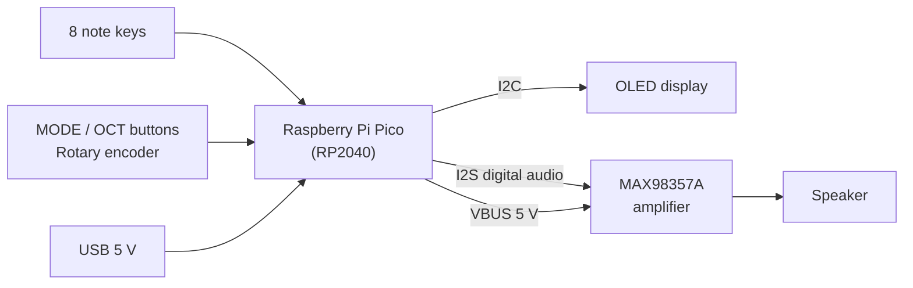

# 🎹 MiniMelody

**A pocket-sized synth keyboard you can build yourself: 8 keys, a live OLED display, a rotary volume knob, and a real speaker, all on one custom PCB.**


<p align="center">
> Built for **Music Week (Week 3), "Design Your Instrument"**: circuits that turn voltage into sound.
  
</p>

---

## 📖 Table of contents

| Jump to | |
|---|---|
| [What is it?](#-what-is-it) | [Hardware](#-hardware) |
| [Features](#-features) | [Pin map](#-pin-map) |
| [How it works](#-how-it-works) | [Build it yourself](#-build-it-yourself) |
| [Controls](#-controls) | [Design decisions](#-design-decisions) |
| [Project structure](#-project-structure) | [Roadmap](#-roadmap) |

---

## 🎵 What is it?

MiniMelody is a small electronic keyboard. Each of the 8 keys plays its own note, and you can press **several keys at once** to play chords and build up music. A small OLED shows the note and sound you are playing, and the audio comes out of a proper speaker through a digital amplifier, so it sounds much better than a basic buzzer.

Everything (schematic, PCB layout, and firmware) is open, so you can rebuild it, change it, or use it to learn how a synth works.

## ✨ Features

- 🎹 **8 note keys:** one octave, from C up to the high C
- 🎶 **Polyphonic:** the firmware mixes multiple notes at the same time (4 voices planned)
- 🔊 **Real speaker output:** clean digital audio (I2S) into a MAX98357A amplifier
- 📺 **OLED display:** shows the current note, sound type, and volume
- 🎛️ **Rotary encoder** for volume, plus **MODE** and **OCT** buttons for sound and octave
- 🧩 **Custom KiCad PCB:** keys, display, speaker, and controller on a single board
- 🔌 **Powered over USB** through the Pico's own port, no battery needed

## ⚙️ How it works




1. **Scan:** the Pico checks every button many times per second. Each button connects its pin to ground when pressed (the Pico's internal pull-up resistors do the rest).
2. **Generate:** for every key held down, the firmware reads a stored waveform (sine, square, saw, or triangle) at that note's frequency and shapes it with a simple volume envelope so notes don't click.
3. **Mix:** the active notes are added together and scaled to avoid distortion.
4. **Play:** the mixed audio is sent to the amplifier over I2S, and the amplifier drives the speaker.
5. **Show:** the OLED updates a few times per second with what is playing.

## 🎛️ Controls

| Control | What it does |
|---|---|
| **8 note keys** | Play C, D, E, F, G, A, B, and high C (hold several for chords) |
| **MODE button** | Cycles through sounds (square, saw, triangle, sine, and so on) |
| **OCT button** | Shifts the whole keyboard up or down an octave |
| **Rotary encoder** | Turn to change the volume |

## 🧰 Hardware

<details>
<summary><b>Bill of materials</b> (click to expand)</summary>

| Qty | Part | Notes |
|---|---|---|
| 1 | Raspberry Pi Pico (RP2040) | Main controller, also provides USB power |
| 1 | MAX98357A I2S amplifier breakout | Drives the speaker |
| 1 | Small speaker, 4 or 8 ohm, about 28 mm | Wired to the 2-pin speaker header |
| 1 | 0.96" 128x64 OLED (SSD1306, I2C) | 4-pin module |
| 10 | Tactile push buttons | 8 note keys, plus MODE and OCT |
| 1 | Rotary encoder | Volume |
| 1 | 10 uF capacitor | Amplifier supply decoupling |
| 1 | 100 nF capacitor | Supply decoupling |
| 1 | 2-pin header | Speaker connection |
| 1 | Custom PCB | Files in `hardware/` |

</details>

### 🔌 Pin map

<details>
<summary><b>Raspberry Pi Pico connections</b> (click to expand)</summary>

| Function | Pico pins | Notes |
|---|---|---|
| I2S DIN / BCLK / LRCLK | GP13 / GP14 / GP15 | LRCLK must be the pin right after BCLK |
| OLED SDA / SCL | GP0 / GP1 | I2C0 |
| Note keys, MODE, OCT, encoder | See `hardware/` schematic | Each button connects its pin to GND |
| Amplifier power | VBUS (5 V) | |
| OLED power | 3V3_OUT | |

> Always check this table against the final schematic in `hardware/`, which is the source of truth.

</details>

## 🗂️ Project structure

```
MiniMelody/
├── hardware/        # KiCad project: schematic, PCB, footprints, 3D models
│   └── gerbers/     # Manufacturing files for ordering the PCB
├── firmware/        # PlatformIO project for the Pico
├── docs/
│   └── images/      # Photos and 3D renders
└── README.md
```


## 🔨 Build it yourself

### 1. Hardware

1. Open the project in **KiCad** and run the Electrical Rules Check and the Design Rules Check. Both should come back clean.
2. Export the **Gerber and drill files** (File > Plot) and send them to a PCB manufacturer.
3. Solder the parts. A good order is: capacitors, buttons, headers, amplifier, Pico, display, and finally the speaker wires.
4. Connect the speaker to the 2-pin header (the amplifier output has no polarity requirement for a basic speaker).

### 2. Firmware

You need [PlatformIO](https://platformio.org/) (VS Code extension or CLI).

```bash
cd firmware
pio run                 # build
pio run -t upload       # flash
```

To flash, hold the **BOOTSEL** button on the Pico while plugging in the USB cable, then run the upload command.

### 3. Play

Plug in USB, wait for the display to light up, and press the keys. 🎶

## 🧠 Design decisions

- **Why a Pico and not an Arduino?** A basic Arduino `tone()` can only play one note at a time. The RP2040 is fast enough to mix several notes in software and stream audio over I2S.
- **Why I2S and an amplifier chip?** Digital audio is much cleaner and louder than PWM into a buzzer.
- **Why no diodes or button matrix?** The Pico has enough pins to give every button its own, so every chord works and the schematic stays simple.
- **Why no pull-up resistors?** The Pico has internal pull-ups on every pin, and the firmware turns them on.
- **Why power the amplifier from 5 V?** It gives the speaker more headroom and volume than 3.3 V.

## 🗺️ Roadmap

- [x] Concept and parts selection
- [x] Schematic in KiCad
- [x] PCB layout and routing
- [ ] Final design checks and PCB order
- [ ] Firmware: button scanning and single-note tone
- [ ] Firmware: polyphonic mixing
- [ ] Firmware: OLED display and sound modes
- [ ] 3D-printed or laser-cut enclosure
- [ ] Demo video

## 🤝 Contributing

Ideas and improvements are welcome. Open an issue or a pull request.

## 📄 License

Released under the [MIT License](LICENSE).

## 👤 Author

Made by **<Ahmad Adesoye>** · [GitHub](https://github.com/ahmadjamal789)

---

<p align="center"><i>Make. Some. Noooooooooise.</i></p>
